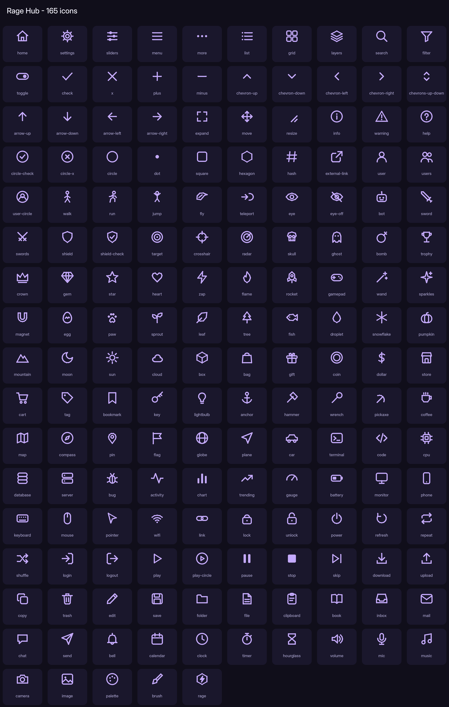

# Rage Hub icons

165 vector icons, drawn with plain Frames (no asset ids, no emoji).

Use them anywhere in the library: `Window:CreateTab("Farm", "sprout")`, `Section:CreateToggle({Icon = "zap"})`,
or in your own UI with `RageHub:CreateIcon(parent, "zap", 20, Color3.new(1,1,1))`.

## Names

`activity`, `anchor`, `arrow-down`, `arrow-left`, `arrow-right`, `arrow-up`, `bag`, `battery`, `bell`, `bomb`, `book`, `bookmark`, `bot`, `box`, `brush`, `bug`, `calendar`, `camera`, `car`, `cart`, `chart`, `chat`, `check`, `chevron-down`, `chevron-left`, `chevron-right`, `chevron-up`, `chevrons-up-down`, `circle`, `circle-check`, `circle-x`, `clipboard`, `clock`, `cloud`, `code`, `coffee`, `coin`, `compass`, `copy`, `cpu`, `crosshair`, `crown`, `database`, `dollar`, `dot`, `download`, `droplet`, `edit`, `egg`, `expand`, `external-link`, `eye`, `eye-off`, `file`, `filter`, `fish`, `flag`, `flame`, `fly`, `folder`, `gamepad`, `gauge`, `gem`, `ghost`, `gift`, `globe`, `grid`, `hammer`, `hash`, `heart`, `help`, `hexagon`, `home`, `hourglass`, `image`, `inbox`, `info`, `jump`, `key`, `keyboard`, `layers`, `leaf`, `lightbulb`, `link`, `list`, `lock`, `login`, `logout`, `magnet`, `mail`, `map`, `menu`, `mic`, `minus`, `monitor`, `moon`, `more`, `mountain`, `mouse`, `move`, `music`, `palette`, `pause`, `paw`, `phone`, `pickaxe`, `pin`, `plane`, `play`, `play-circle`, `plus`, `pointer`, `power`, `pumpkin`, `radar`, `rage`, `refresh`, `repeat`, `resize`, `rocket`, `run`, `save`, `search`, `send`, `server`, `settings`, `shield`, `shield-check`, `shuffle`, `skip`, `skull`, `sliders`, `snowflake`, `sparkles`, `sprout`, `square`, `star`, `stop`, `store`, `sun`, `sword`, `swords`, `tag`, `target`, `teleport`, `terminal`, `timer`, `toggle`, `trash`, `tree`, `trending`, `trophy`, `unlock`, `upload`, `user`, `user-circle`, `users`, `volume`, `walk`, `wand`, `warning`, `wifi`, `wrench`, `x`, `zap`

## Aliases

`account` -> `user-circle`, `afk` -> `coffee`, `aimbot` -> `crosshair`, `alert` -> `warning`, `anti-afk` -> `coffee`, `auto` -> `bot`, `automation` -> `bot`, `avatar` -> `user`, `back` -> `chevron-left`, `bolt` -> `zap`, `boss` -> `skull`, `buy` -> `cart`, `cash` -> `dollar`, `close` -> `x`, `cog` -> `settings`, `combat` -> `sword`, `config` -> `save`, `console` -> `terminal`, `dark` -> `moon`, `discord` -> `chat`, `down` -> `chevron-down`, `eggs` -> `egg`, `error` -> `circle-x`, `esp` -> `eye`, `event` -> `calendar`, `events` -> `calendar`, `executor` -> `terminal`, `exit` -> `logout`, `farm` -> `sprout`, `farm-bot` -> `bot`, `fling` -> `zap`, `fly-mode` -> `fly`, `forest` -> `tree`, `fps` -> `gauge`, `gear` -> `settings`, `godmode` -> `shield`, `halloween` -> `pumpkin`, `hop` -> `shuffle`, `info-circle` -> `info`, `join` -> `login`, `light` -> `sun`, `lightning` -> `zap`, `location` -> `pin`, `logo` -> `rage`, `logs` -> `file`, `map-pin` -> `pin`, `misc` -> `grid`, `mobile` -> `phone`, `money` -> `coin`, `movement` -> `run`, `next` -> `chevron-right`, `noclip` -> `ghost`, `notification` -> `bell`, `pc` -> `monitor`, `performance` -> `gauge`, `pet` -> `paw`, `pets` -> `paw`, `plant` -> `sprout`, `player` -> `user`, `premium` -> `crown`, `profile` -> `user-circle`, `pvp` -> `swords`, `quest` -> `flag`, `ragehub` -> `rage`, `reconnect` -> `refresh`, `rejoin` -> `refresh`, `script` -> `code`, `server-hop` -> `shuffle`, `shop` -> `store`, `speed` -> `run`, `stats` -> `chart`, `success` -> `circle-check`, `tasks` -> `clipboard`, `teleports` -> `teleport`, `theme` -> `palette`, `tp` -> `teleport`, `ui` -> `monitor`, `unload` -> `power`, `up` -> `chevron-up`, `update` -> `download`, `vip` -> `crown`, `visuals` -> `eye`, `water` -> `droplet`, `webhook` -> `link`, `winter` -> `snowflake`, `world` -> `globe`
