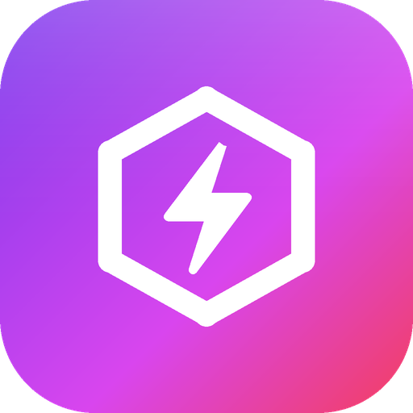

<p align="center"></p>

<h1 align="center">Rage Hub</h1>
<p align="center">A modern, clean, lag-friendly Roblox UI library for <b>mobile and PC</b>.<br>
Glass UI · 165 built-in vector icons (no emoji, no asset ids) · dashboard · built-in Settings tab</p>

```lua
local RageHub = loadstring(game:HttpGet("https://raw.githubusercontent.com/devnamegelo/Rage-Hub/main/RageHub.lua"))()
```

## Features

- **Glass UI**: frosted translucent window, glass edge highlight, soft sheen. One clean theme, no clutter.
- **Mobile + PC**: auto scales to the screen, touch-friendly, draggable and resizable window, collapsible sidebar (expanded by default with icon + name), 1 or 2 column pages depending on width. The window and the floating button have a wall on every edge, so they can never be dragged off screen.
- **Built for low lag**: no per-frame loops, drag handlers only exist while a finger/mouse is down, popups are built lazily and reused, notification cap, and a *Reduce Animations* switch.
- **165 real icons**: drawn with Frames from a 24x24 vector grid, tintable and sharp at any size. Preview in [ICONS.md](ICONS.md).
- **Elements**: Toggle, Slider (typeable value), Dropdown (single / multi / search), Button, Input, Keybind, Color Picker, Label, Paragraph, Divider.
- **Dashboard** (one line): profile, session time, FPS, ping, players, game, executor, quick actions and an activity log. Fully customizable.
- **Auto Reconnect + Anti AFK ON by default.** Reconnects after kick, disconnect or any error. If the server doesn't respond it tries the same server, then any server, then hops to other servers and skips full ones.
- **Config auto save + auto load ON by default.** The library creates the config folder itself.
- **Built-in Settings tab** (one line): Auto Reconnect, Same Server First, Auto Execute, Anti AFK, Server Hop (least / most / random, retries the next server if one is full), Rejoin, Copy / Join Job ID, UI Scale, Glass Transparency, Toggle Key, Floating Button, Compact Sidebar, Reduce Animations, FPS Cap, Low Graphics, White Screen, Config manager, Unload.

## Quick start

```lua
local RageHub = loadstring(game:HttpGet("https://raw.githubusercontent.com/devnamegelo/Rage-Hub/main/RageHub.lua"))()

local Window = RageHub:CreateWindow({
    Name = "Rage Hub",
    Subtitle = "My Game",
    ToggleKey = Enum.KeyCode.RightControl,   -- PC only, mobile uses the floating button
    AutoExecuteURL = "https://example.com/my_script.lua",   -- see "Auto Execute" below
})

local Dash = Window:CreateDashboard()

local Tab = Window:CreateTab("Farm", "sprout")          -- any icon name from ICONS.md
local Section = Tab:CreateSection("Auto Farm", "zap")

Section:CreateToggle({
    Name = "Auto Farm", Description = "Farms for you.", Flag = "AutoFarm", Default = false,
    Callback = function(on) print(on) end,
})

Window:CreateTabLabel("System")
Window:CreateSettingsTab()      -- Auto Reconnect, Auto Execute, Anti AFK, Server Hop, FPS, Config ...
```

That is all: configs save and load by themselves. A full example is in [`examples/Example.lua`](examples/Example.lua).

## Auto Execute (set by YOU, the script developer)

Players never type a URL. You put the link of your own script in `CreateWindow`:

```lua
local Window = RageHub:CreateWindow({
    Name = "My Hub",
    AutoExecuteURL = "https://raw.githubusercontent.com/you/repo/main/main.lua",
    -- or raw code instead of a link:
    -- AutoExecuteScript = 'loadstring(game:HttpGet("https://..."))()',
})
-- or later:  Window:SetAutoExecute("https://...")
```

- URL set: Auto Execute is **ON by default** and re-runs your script after reconnect, rejoin and server hop.
- URL not set: the Settings tab shows **"Auto Execute URL is not configured yet."** with these instructions, and the toggle stays off.
- It uses your executor's `queue_on_teleport`. Rejoining by hand from the Roblox menu does not fire a teleport, so use the built-in Rejoin button.

## Dashboard

```lua
local Dash = Window:CreateDashboard({
    -- Widgets = { Profile = true, Overview = true, Game = true, Actions = true, Activity = true },
})
```

Default widgets: **Profile** (avatar, name, user id, account age), **Overview** (session time, FPS, ping, players), **Game** (game name, place id, job id, executor), **Quick Actions** (Rejoin, Copy Job ID), **Activity** (log of everything the hub does, plus your `Window:Log()` calls).
The defaults are generic: there is no Discord button and no egg log. Add or remove whatever you want:

```lua
local eggs = Dash:AddStat({ Id = "Eggs", Name = "Eggs Stolen", Value = 0, Icon = "egg" })  -- eggs:Set(10)
local log  = Dash:CreateLog({ Name = "Egg Steals", Icon = "egg" })                           -- log:Add("Stole a Sunlion Egg", "success")
Dash:AddUpdate({ Version = "v1.2", Title = "New zone", Text = "Added the Hollow.", Date = "Nov 12" })
Dash:AddButton({ Name = "Discord", ButtonText = "Copy", Icon = "chat", Callback = function() setclipboard("https://discord.gg/...") end })
local card = Dash:AddSection("My Card", "star")   -- a normal section: toggles, labels, sliders...
Dash:RemoveWidget("Profile")                       -- Profile, Overview, Game, Actions, Activity, Updates
```

`Window:Log(text, "info" | "success" | "warning" | "error")` writes to the Activity log. Notifications are logged automatically.

## Config

On by default: **Auto Save** (every change is saved after 1.5 s) and **Auto Load** (loaded when the script starts, after your UI is built). Files live in `<executor workspace>/<ConfigFolder>/configs/<name>.json`, plus `meta.json` for the settings above. Change the config name, save, load or delete from the Settings tab. Elements need a `Flag` to be saved, `Save = false` keeps one out.

## API

### Library
| Call | Description |
|---|---|
| `RageHub:CreateWindow(cfg)` | `Name, Subtitle, Version, Size (Vector2), ToggleKey, ConfigFolder, ConfigName, AutoExecuteURL, AutoExecuteScript, FloatingButton, CompactSidebar, StartHidden` |
| `RageHub:Notify({Title, Content, Type, Duration, Icon})` | `Type`: `info`, `success`, `warning`, `error` |
| `RageHub:CreateIcon(parent, name, size, color)` | Use the icons in your own UI. `color` can be a `Color3` or a color key like `"Accent"`, `"Text"` |
| `RageHub:GetIcons()` / `RageHub:HasIcon(name)` | List icon names |
| `RageHub.Flags` / `RageHub.Options` | Current values / element objects by `Flag` |
| `RageHub:Unload()` | Remove everything |

### Window
`Window:CreateTab(name, icon)` · `Window:CreateDashboard(opts)` · `Window:SetAutoExecute(urlOrCode)` · `Window:Log(text, kind)` · `Window:CreateTabLabel(text)` · `Window:CreateSettingsTab()` · `Window:SelectTab(tabOrName)` · `Window:Toggle()` · `Window:SetVisible(bool)` · `Window:SetScale(n)` · `Window:SetTransparency(0-0.8)` · `Window:SetCollapsed(bool)` · `Window:SetToggleKey(key)` · `Window:Notify(cfg)` · `Window:Rejoin()` · `Window:ServerHop("Least Players" | "Most Players" | "Random")` · `Window:JoinServer(jobId)` · `Window:SaveConfig(name)` · `Window:LoadConfig(name)` · `Window:DeleteConfig(name)` · `Window:ListConfigs()` · `Window:AutoLoad()` · `Window:Destroy()`

### Tab / Section
`Tab:CreateSection(name, icon, {Side = "Left" | "Right"})`. You can also call any element directly on a tab and it goes into a default section.

| Element | Config | Methods |
|---|---|---|
| `CreateToggle` | `Name, Description, Default, Flag, Callback(bool)` | `Set(bool)` |
| `CreateSlider` | `Name, Min, Max, Increment, Default, Suffix, Flag, Callback(number)` | `Set(n)` |
| `CreateDropdown` | `Name, Options, Default, Multi, Search, Flag, Callback(value)` | `Set(v)`, `Refresh(options, keepValue)` |
| `CreateButton` | `Name, Description, ButtonText, Icon, Danger, Callback()` | `Fire()` |
| `CreateInput` | `Name, Default, Placeholder, Numeric, Flag, Callback(text)` | `Set(v)` |
| `CreateKeybind` | `Name, Default (KeyCode), Flag, Callback(key) (on press), OnChanged(key)` | `Set(key)` |
| `CreateColorPicker` | `Name, Default (Color3), Flag, Callback(color)` | `Set(color)` |
| `CreateLabel` | `Text, Icon` | `Set(text)` |
| `CreateParagraph` | `Title, Content` | `Set(title, content)` |
| `CreateDivider` | - | - |

Every element also has `SetName`, `SetDescription`, `SetVisible`, `Destroy`, and `.Value`.
Callbacks run once on creation with the default value; pass `CallOnCreate = false` to skip that. `Save = false` keeps an element out of configs.

## Repo layout

```
RageHub.lua          <- the library (this is the file the raw URL loads)
examples/Example.lua
assets/logo.png|svg  assets/icons-preview.png
ICONS.md             all icon names
src/                 library sources (split by area)
tools/gen_icons.py   icon source of truth + preview/logo generator
tools/build.py       rebuilds RageHub.lua from src/
```

Change icons: edit `tools/gen_icons.py`, run `python3 tools/gen_icons.py && python3 tools/build.py`.

MIT licensed.
